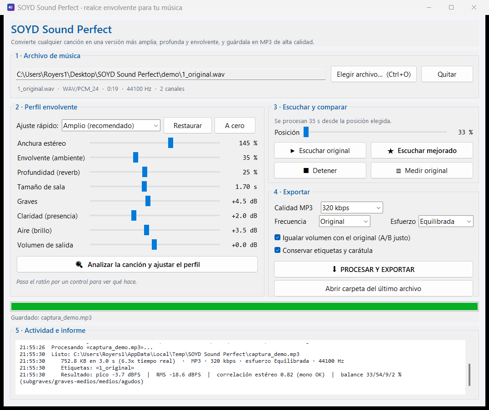

# SOYD Sound Perfect

Aplicación de escritorio para Windows que coge una canción y la convierte en una
versión **más amplia, profunda y envolvente**, y la guarda en **MP3** con el
bitrate que elijas (hasta 320 kbps).

No necesita ffmpeg ni programas externos: lee y escribe el audio por sí misma.

**Y es portátil:** lleva dentro su propio motor (Python + librerías), así que
funciona en cualquier PC con Windows, desde cualquier carpeta o un pendrive, sin
instalar nada. Solo tienes que copiar la carpeta entera.



---

## Inicio rápido

1. Doble clic en **`INICIAR.bat`**.
2. Pulsa **Elegir archivo…** y selecciona tu canción. La app la analiza sola y te
   cuenta en el registro cómo es (cresta, balance de graves/agudos, imagen estéreo).
3. Pulsa **🔍 Analizar la canción y ajustar el perfil** si quieres que adapte los
   controles a ese material en concreto.
4. Pulsa **★ Escuchar mejorado** para oír 35 segundos de la versión realzada y
   compararla con **▶ Escuchar original**.
5. Cuando te guste, pulsa **⬇ PROCESAR Y EXPORTAR** y elige dónde guardar el MP3.

> ¿Prefieres la línea de comandos? `python app.py` abre exactamente la misma ventana.

---

## La ventana, paso a paso

### 1 · Archivo de música
Carga la canción. Debajo verás el formato, la duración, la frecuencia de muestreo
y el número de canales. Si el archivo es **mono**, la app lo convierte
automáticamente en un estéreo envolvente.

### 2 · Perfil envolvente
Ocho controles, con perfiles predefinidos para no tener que tocar nada:

| Control | Qué hace |
|---|---|
| **Anchura estéreo** | Abre la imagen entre los altavoces. 100 % = igual que el original; 145 % es el valor del perfil recomendado. Los graves se mantienen centrados para no perder pegada. |
| **Envolvente (ambiente)** | Añade reflexiones laterales retardadas que te "rodean". Es 100 % compatible en mono: la suma izquierda+derecha no cambia. |
| **Profundidad (reverb)** | Cantidad de cola de sala mezclada con la señal original. |
| **Tamaño de sala** | Duración de esa cola, de 0,4 s (sala pequeña) a 3,5 s (catedral). |
| **Graves** | Realce del bajo y el bombo (shelf a 95 Hz), aplicado al centro. |
| **Claridad (presencia)** | Realce alrededor de 3 kHz: voces e instrumentos más definidos. |
| **Aire (brillo)** | Realce de agudos altos, sensación de espacio y detalle. |
| **Volumen de salida** | Ajuste final de nivel, de −6 a +6 dB. |

**Perfiles incluidos:** *Suave*, **Amplio (recomendado)**, *Concierto*, *Club*,
*Solo anchura (sin reverb)* y *Plano (referencia)* — este último deja el audio
intacto para comparar. El botón **Restaurar** vuelve al perfil recomendado y
**A cero** deja todo plano.

#### 🔍 Analizar la canción y ajustar el perfil

Este botón hace que la app **escuche primero** la canción y adapte el perfil a lo
que ha medido, en vez de aplicar los mismos valores a todo. Mide tres cosas y las
cruza:

| Qué mide | Cómo lo usa |
|---|---|
| **Cresta** (pico − RMS) | Una canción muy comprimida (cresta baja) no admite cola: reduce profundidad y ambiente. Una dinámica (clásica, acústica) admite más sala. |
| **Balance espectral** por bandas | Si ya trae mucho grave, no lo refuerza; si tiene cuerpo pero poco peso abajo, lo sube; si la grabación *no tiene* contenido bajo, no lo toca (subirlo solo añadiría barro). Si suena apagada arriba, sube el aire; si ya es brillante, lo baja. |
| **Anchura** (energía lateral / central) | Si la imagen ya es amplia, no la abre más para no volverla inestable. Si es mono o casi, aprovecha el margen. |

Los ajustes son **multiplicativos sobre el perfil que tengas elegido**, así que no
le cambian el carácter: si has puesto *Concierto*, sigue sonando a concierto, solo
que con los graves y la reverb que admite esa canción en concreto.

Y sobre todo: **te dice lo que hace y por qué**, línea a línea, en el registro:

```
Análisis de la canción: cresta 2.8 dB · RMS -3.3 dBFS · ancho 0.82 ·
                        balance 74/11/1/9 %  ·  ya muy ancha, muy comprimida,
                        muy cargada de graves
   Graves: +4.5 → +1.6 dB      ·   porque la canción ya trae el 74 % de su energía en graves
   Profundidad: 22 % → 12 %    ·   porque está muy comprimida (cresta 2.8 dB): menos cola para no embarrar
   Anchura estéreo: 145 % → 109 %  ·   porque la imagen ya es muy amplia (ancho 0.82)
```

Al cargar cualquier archivo, la app ya analiza y te enseña ese diagnóstico; el
botón es el que aplica los ajustes. Siempre puedes mover los controles a mano
después: el ajuste automático es un punto de partida, no una imposición.

### 3 · Escuchar y comparar
- **Posición**: desde qué punto de la canción se toman los 35 segundos de escucha.
- **▶ Escuchar original** / **★ Escuchar mejorado**: comparación A/B inmediata.
- **■ Detener** y **▧ Medir original**, que imprime en el registro un informe
  objetivo del original (pico, RMS, correlación estéreo y balance de bandas).

### 4 · Exportar
- **Calidad MP3**: 128, 160, 192, 224, 256 o 320 kbps.
- **Frecuencia**: la del original, 44 100 Hz o 48 000 Hz.
- **Esfuerzo**: cuánto analiza el codificador MP3. *Rápida*, *Equilibrada* (la
  recomendada) o *Máxima*. **A igual bitrate el archivo pesa exactamente lo
  mismo** en los tres casos: solo cambia el tiempo que tarda en codificar.
  Si tienes prisa, *Rápida* termina en la mitad de tiempo que *Máxima*.
- **Igualar volumen con el original**: deja el resultado al mismo volumen
  percibido que la entrada, para que al comparar oigas el *efecto* y no un simple
  aumento de volumen. Muy recomendable.
- **Conservar etiquetas y carátula**: copia del archivo original el título,
  artista, álbum, año, género, número de pista y comentario, **más la carátula**.
  Si el original no tiene título, se usa el nombre del archivo (con los guiones
  bajos convertidos en espacios). En MP3, WAV y FLAC se guarda también la imagen;
  en Opus no, porque el formato no la admite de la misma forma.
- También puedes guardar en **WAV** o **FLAC** sin pérdidas, y en **OGG/Opus**,
  cambiando la extensión en el diálogo de guardado.

### 5 · Actividad e informe
Registro con marcas de tiempo: análisis del original, progreso del procesado y,
al terminar, el informe de la versión realzada junto al tiempo empleado.

---

## Cómo funciona (cadena de proceso)

1. **Preparación** — paso alto a 26 Hz para quitar rumble y continua; si la
   entrada es mono, se genera un pseudoestéreo por efecto Haas que conserva la
   suma mono.
2. **Graves** — shelf a 95 Hz aplicado **solo al componente mono**, de modo que
   el ensanchado no descoloque el bajo ni el bombo.
3. **Anchura** — procesado *mid/side* dependiente de frecuencia: el canal
   lateral se abre por encima de 190 Hz y se queda prácticamente centrado por
   debajo, que es donde el estéreo solo crea problemas.
4. **Ambiente** — se extrae la diferencia L−R, se filtra (260 Hz – 7 kHz) y se
   reinyecta retardada y en antifase: `L' = L + a·E`, `R' = R − a·E`. Resultado:
   sensación envolvente y `L'+R' = L+R`, es decir, **compatible en mono**.
5. **Profundidad** — convolución con una respuesta al impulso de sala
   sintetizada (cola exponencial con los agudos decayendo antes, reflexiones
   tempranas y tiempo de pre-retardo), **distinta para cada canal**, que es lo
   que produce la sensación de envolvimiento. La convolución se hace por bloques
   con FFT para no disparar la memoria.
6. **Tono** — campana de presencia a 3 kHz y shelf de aire a 9,5 kHz.
7. **Salida** — igualación de volumen percibido (RMS), ganancia de salida,
   limitador **por ganancia** (no recorta ni satura, así que no genera armónicos)
   y techo a −1,5 dBFS. Ese margen no es arbitrario: al codificar a MP3 el pico
   *real* (entre muestras) sube, y 1,5 dB es lo medido para que el MP3
   decodificado se quede por debajo de 0 dBTP.

### Metadatos

El MP3, WAV y FLAC de salida llevan etiquetas **ID3v2.3** (la versión que mejor
leen Windows y los reproductores) y, cuando el original la tiene, la carátula
incrustada. La app lee las etiquetas de MP3, WAV, AIFF, FLAC y Ogg/Opus, así que
puedes reprocesar un archivo ya realzado sin perder los datos.

### Rendimiento

Medido en este equipo con una canción de **4 minutos a 320 kbps**:

| Fase | Tiempo |
|---|---|
| Realce envolvente (DSP) | 14,4 s |
| Codificación MP3, esfuerzo *Máxima* | 38,1 s |
| Codificación MP3, esfuerzo *Equilibrada* (por defecto) | 18,5 s |
| Codificación MP3, esfuerzo *Rápida* | 9,4 s |
| **Total por defecto** | **~33 s** (~24 s en modo *Rápido*) |

El codificador MP3 es la parte más lenta del proceso, por eso el esfuerzo por
defecto es *Equilibrada* (el valor que LAME usa de serie): a 192 kbps o más la
diferencia de calidad frente a *Máxima* es inapreciable, pero **codifica el doble
de rápido y produce un archivo del mismo tamaño**.

Durante la exportación la barra avanza de verdad en las dos fases: primero el
realce (0-87 %) y después la codificación (87-100 %), con el porcentaje en
pantalla, para que nunca parezca colgada.

> **Nota sobre el limitador de pico real.** Se probó a implementarlo midiendo el
> pico *entre muestras* con sobremuestreo 4×, que es lo ortodoxo. Dos medidas lo
> descartaron: el análisis preciso cuesta **+20 s por canción** (más que todo el
> realce junto), y la versión rápida se equivoca hasta 1,5 dB en material con
> energía a full scale pegada a Nyquist. Con música real, en cambio, el techo de
> −1,5 dBFS deja el MP3 en −1,33 dBTP, así que el objetivo (que no recorte) se
> consigue igual y sin coste. Si algún día quieres el modo estricto, se puede
> añadir como opción.

---

## Formatos

**Entrada:** MP3, WAV, FLAC, OGG/Vorbis, Opus, AIFF, AU, CAF, W64.
**Salida:** MP3 (128–320 kbps), WAV (16/24 bits), FLAC (24 bits), OGG/Opus.

Los formatos **AAC/M4A y WMA no están soportados** (no se pueden decodificar sin
ffmpeg ni códecs del sistema). Si eliges uno de ellos, la app te lo dirá.

> **Por qué la salida es Opus y no Vorbis.** El codificador Vorbis de la librería
> de audio que usa la app (libsndfile 1.2.2) provoca un **desbordamiento de pila**
> —un cierre inmediato del programa, no un error recuperable— con cualquier
> archivo de más de unos segundos. Está comprobado: 5 s se escriben bien y 19 s
> tumban el proceso. Por eso la app **nunca escribe Vorbis** y usa Opus, que es
> estable, admite cualquier duración y da más calidad por bit. Opus trabaja a
> 48 kHz, así que la app remuestrea automáticamente si tu archivo está a 44,1 kHz.

---

## Demo incluida

En la carpeta `demo/` tienes música sintetizada para probar sin usar tus
canciones:

- `1_original.mp3` — el audio de partida.
- `2_envolvente.mp3` — el mismo audio tras el realce (perfil *Amplio*).
- `informe_demo.txt` — las métricas antes/después.

> El `1_original.wav` sin pérdidas (4,9 MB) **no está en el repositorio** para no
> engordarlo: se regenera junto al resto con `python demo.py`.

Escúchalos seguidos para hacerte una idea del efecto. Para regenerarlos o probar
otro perfil:

```bat
python demo.py
python demo.py --preset "Concierto" --segundos 40
```

---

## Comprobaciones automáticas

```bat
python autotest.py
```

Verifica **32 propiedades** del motor: que el ambiente no altera la suma mono, que
los graves siguen centrados al ensanchar, que la reverb deja cola, que el
limitador respeta el techo **sin deformar la onda**, que el perfil automático
ajusta bien cada tipo de material y que no inventa cambios donde no toca, el
remuestreo, la ida y vuelta MP3 (byte a byte), la copia de etiquetas y carátula,
que el MP3 de música real no recorta, la exportación a WAV/FLAC/Opus, que la
interfaz exporte sin errores de hilos y el rendimiento.

---

## Problemas frecuentes

| Síntoma | Solución |
|---|---|
| No se oye nada al pulsar *Escuchar* | Comprueba el volumen del sistema. La escucha se reproduce por los altavoces predeterminados de Windows. |
| «No se ha podido leer ese archivo» | Es un formato no soportado (M4A/AAC/WMA) o el archivo está dañado. Conviértelo antes a MP3, WAV o FLAC. |
| El MP3 final suena más flojo que el original | Desactiva *Igualar volumen con el original* o sube **Volumen de salida**. La igualación hace que el volumen percibido sea el mismo a propósito. |
| En mono se oye raro | Con *Envolvente* muy alto es normal que la reverb pierda algo de cuerpo en mono, pero la app mantiene los graves centrados y nunca se cancela el centro. Baja un poco **Anchura estéreo**. |
| Va lento con canciones muy largas | Pon el **Esfuerzo** en *Rápida* (codifica en la mitad de tiempo sin cambiar el tamaño del archivo) y baja **Tamaño de sala**, que es lo que más pesa en el realce. También puedes bajar el bitrate. La ventana sigue respondiendo mientras trabaja. |
| Tarda hasta medio minuto en abrir la primera vez | Es Windows Defender analizando el motor recién copiado. Solo pasa la primera vez en cada carpeta nueva; después abre en 4 segundos. |
| La moví a otro PC y no arranca | Copia la carpeta **entera**, incluida `runtime\`. Si falta esa subcarpeta, no hay motor. |
| Borré `runtime\` por error | Ejecuta **`INSTALAR_DEPENDENCIAS.bat`** con un Python del sistema instalado, o vuelve a copiar la carpeta completa. |

---

## Estructura del proyecto

```
SOYD Sound Perfect/
├─ INICIAR.bat                  lanzador de la aplicación
├─ INSTALAR_DEPENDENCIAS.bat    repara o amplía el motor (rara vez hace falta)
├─ app.py                       interfaz gráfica (Tkinter)
├─ autotest.py                  32 comprobaciones automáticas
├─ demo.py                      generador de la música de demo
├─ crear_icono.py               genera icono.ico desde código
├─ captura.png                  captura de la interfaz
├─ requirements.txt             dependencias, por si hay que reinstalarlas
├─ LICENSE                      GNU General Public License v3
├─ THIRD_PARTY_LICENSES.md      licencias de las librerías que van dentro
├─ .gitignore                   excluye runtime/ y las cachés de Python
├─ herramientas/
│  └─ crear_portatil.ps1        construye el ZIP portátil desde el código fuente
├─ soyd_sound_perfect/          motor de la app (con guion bajo: es un paquete Python)
│  ├─ params.py                 perfiles y controles (ligero: sin numpy ni scipy)
│  ├─ dsp.py                    filtros, reverb, limitador y perfil automático
│  ├─ audio_io.py               lectura/escritura MP3/WAV/FLAC/Opus, etiquetas, reproducción
│  └─ __init__.py
├─ runtime/                     ← EL MOTOR PORTÁTIL (Python 3.12 + librerías)
│                                 210 MB · NO está en el repositorio: se descarga
│                                 del ZIP publicado en «Releases»
└─ demo/                        audio de ejemplo y su informe
```

> **No borres ni muevas `runtime/`.** Es el Python y las librerías que hacen
> funcionar la app sin instalar nada. Si lo borras, `INICIAR.bat` intentará usar
> el Python del sistema y, si no lo hay, la app no arrancará.

---

## Instalar desde el código fuente

Si has clonado el repositorio (sin el ZIP portátil) necesitas un **Python 3.10 o
superior** instalado en el sistema:

```bat
python -m pip install -r requirements.txt
python app.py
```

Eso es todo: son **0,2 MB de código** y cinco dependencias. Para comprobar que
todo está en orden:

```bat
python autotest.py
```

---

## Crear la versión portátil

La carpeta `runtime/` **no se sube a Git** (son 210 MB de binarios: harían los
clones lentísimos y el historial no se podría limpiar). Se genera con el script
incluido y se publica como ZIP en la sección **Releases** de GitHub:

```powershell
powershell -ExecutionPolicy Bypass -File herramientas\crear_portatil.ps1
```

El script copia un Python 3.12 completo junto al código, le quita los paquetes que
la app no usa (pandas, lxml, openpyxl…) y precompila el bytecode. Al terminar
indica el tamaño y deja el ZIP listo para subir.

**Requisitos del script:** un Python 3.12 en el sistema con numpy, scipy,
soundfile, lameenc, mutagen y Pillow instalados (es el que se copia).

---

## Licencia

**SOYD Sound Perfect** se distribuye bajo la **GNU General Public License,
versión 3 o posterior** ([LICENSE](LICENSE)).

En la práctica:

- **Puedes** usarlo, copiarlo a tus equipos, modificarlo y redistribuirlo, también
  con fines comerciales.
- **Debes** mantener la autoría y publicar bajo la misma licencia cualquier
  versión modificada que distribuyas.
- **No hay garantía** de ningún tipo: úsalo bajo tu responsabilidad.

Esa licencia es la coherente con las librerías que lleva dentro (ver
[THIRD_PARTY_LICENSES.md](THIRD_PARTY_LICENSES.md)): mutagen es GPL y lameenc y
libsndfile son LGPL.

El **uso personal** no te obliga a nada: puedes procesar tu música y quedarte los
MP3 sin ninguna condición.

---

## Summary (English)

**SOYD Sound Perfect** is a Windows desktop app that makes music sound wider,
deeper and more enveloping — stereo widening, room depth and solid bass — and
exports it to **MP3 up to 320 kbps**, preserving tags and cover art. It also
analyses each track and adapts the profile to the material.

- **No dependencies:** reads and writes audio by itself (no ffmpeg needed).
- **Portable:** the Release ZIP bundles its own Python runtime — copy the folder
  anywhere (a USB stick, another PC) and it just works. ~220 MB.
- **Verified:** 32 automated checks, including mono compatibility, peak ceiling
  and MP3 round-trip.
- **Licence:** GPL-3.0-or-later.

Built with Python, NumPy, SciPy, libsndfile, LAME and mutagen.

---

## Portabilidad

La aplicación **no depende de nada instalado en el equipo**. Lleva dentro un
Python 3.12 completo con todo lo que necesita:

| | |
|---|---|
| **Tamaño total** | unos **240 MB** (de los cuales 216 MB son el motor) |
| **Qué lleva dentro** | Python 3.12, numpy, scipy, libsndfile, LAME, mutagen y Tk |
| **Qué NO necesita** | ni Python instalado, ni ffmpeg, ni permisos de administrador, ni internet |

**Para llevártela a otro PC o a un pendrive:** copia la carpeta **entera**
(`SOYD Sound Perfect`) y listo. Nada más.

### Cuánto tarda en abrir

| Fase | Tiempo medido |
|---|---|
| **Ventana visible** | **~2 s** (4 s lanzando desde el acceso directo) |
| Carga del motor de cálculo | ~6 s, **solo la primera vez** que analizas o procesas |
| Analizar una canción | menos de 1 s |
| Primer arranque en una carpeta nueva | hasta ~30 s (antivirus escaneando) |

La app está diseñada para **abrirse antes de cargar el motor**: los controles y
los perfiles viven en un módulo ligero (`params.py`) y el motor pesado
(`dsp.py`, que arrastra scipy) se carga en segundo plano la primera vez que hace
falta, con su barra de progreso. Así la ventana responde enseguida en lugar de
quedarse en negro varios segundos.

**Un aviso útil:** la **primera vez** que se abre desde una carpeta nueva, Windows
Defender analiza el motor recién copiado y el arranque puede tardar **hasta medio
minuto**. Es solo la primera vez en cada ubicación; después abre en 4 segundos.

---

## Notas

- Todo el procesado es **local**: ninguna canción sale de tu equipo.
- Los archivos temporales de escucha se guardan en
  `%TEMP%\SOYD Sound Perfect` y se van reemplazando solos.
- La app nunca sube el pico por encima de −1 dBFS, así que no hay recorte
  digital ni distorsión por saturación.
